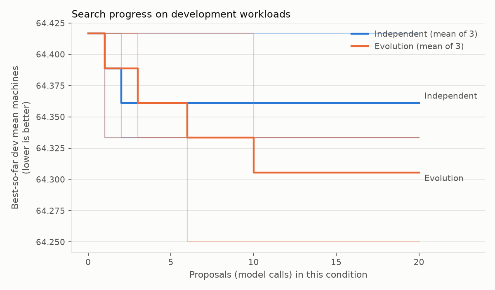
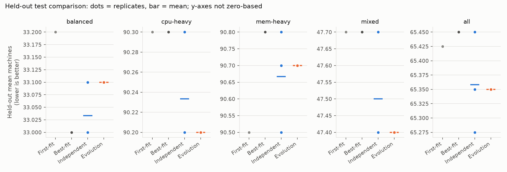

# AlphaEvolve-Mini: Evolution vs. Independent Sampling on Online Bin Packing

**Run:** `main01` · **Model:** `gemini-3.8-flash` · **Code commit:** `7baf598` · **Date:** 2026-11-14

## Summary

We asked an LLM to improve a machine-placement heuristic for online 2D bin packing, under two prompting conditions:

- **Evolution:** each prompt shows the best program found so far, with its feedback.
- **Independent:** each prompt shows the original program, with its feedback.

Both conditions found programs that beat the best-fit baseline on unseen test workloads, but only by **0.15–0.27% fewer machines**. On the test set the two conditions are **essentially tied**:

| Condition | Mean machines (test, average of 3 replicates) |
| --- | --- |
| Evolution | 65.350 |
| Independent | 65.358 |
| Best-fit baseline | 65.450 |

Evolution was more consistent: it improved in all three replicates, against two of three for independent. Independent produced the single best program. Evolution's advantage on the development set did not carry over to the test set. With three replicates and differences this small, we make no claim of a significant difference.

## 1. The task

- **Machines:** each machine has 1000 units of CPU and 1000 units of memory.
- **Jobs:** jobs arrive one at a time and never leave. Each has an integer CPU demand and memory demand.
- **What the LLM writes:** one Python function, `score(job_cpu, job_mem, free_cpu, free_mem)`.
  - For each job, the evaluator calls `score` on every existing machine that can fit the job.
  - The job goes to the machine with the highest score. Ties go to the earliest machine.
  - A new machine is opened only when no existing machine fits the job.
- **Objective:** minimize the mean number of machines used.
- **Starting program:** best-fit, which prefers the machine with the least total CPU plus memory left over after placement:

  ```python
  def score(job_cpu, job_mem, free_cpu, free_mem):
      return -((free_cpu - job_cpu) + (free_mem - job_mem)) / 1000
  ```

**Workloads.** There are four workload families:

- **balanced:** CPU and memory demands are similar.
- **cpu_heavy:** jobs mostly need CPU.
- **mem_heavy:** jobs mostly need memory.
- **mixed:** each job is drawn from one of the other three families.

The workloads are split as follows:

| Split | Instances | Seed | Used for |
| --- | --- | --- | --- |
| Development | 12 (3 per family) | 1001 | Feedback in prompts and selecting each search's winner |
| Test | 40 (10 per family) | 2002 | Measured once, after the winners were frozen |

Each instance has 100 jobs. The test data was never shown to the model or used for selection. The run is marked `test_exposed` before any test data is read.

## 2. Method

**Conditions.**

- Both conditions use the same prompt template.
- The only difference is which program and feedback go into the prompt.
- There is no conversation history. Each proposal is a fresh request.
- An evolution program replaces the incumbent only if it uses strictly fewer total development machines.

The prompt contains:

- the task rules and the program constraints;
- the current program;
- the mean machines used per family on the development set;
- a request to write a short analysis (about 250 words) of why the program wastes machines;
- a request for one improved function.

**Budget.**

- 20 proposals per condition per replicate.
- 3 replicates, for 120 proposals in total.
- Within each replicate, the order of the two conditions was randomized and the requests were interleaved.

**Winner selection.** Each search's winner is its program with the lowest development score, with the starting program included as a candidate. Ties go to the earliest program. Only the six frozen winners were then evaluated on the test set.

**Model settings.**

- Temperature 1.0.
- Max output 16,384 tokens.
- Thinking budget 2,048 tokens.

**Safety and integrity.**

- Generated programs are checked against an allow-list of Python syntax: arithmetic, comparisons, `if`, and `abs`/`min`/`max` only.
- Programs run only inside a locked-down Docker container. It has no network, a read-only filesystem, and an unprivileged user, and it has no access to the test split during search.
- The host re-checks every placement with a trusted simulator.

## 3. Results

### 3.1 Search on the development set

Lower is better.

| Replicate | Condition | Valid proposals | Best dev mean | Winner from |
| --- | --- | --- | --- | --- |
| 0 | independent | 20 / 20 | 64.417 | starting program (no improvement) |
| 0 | evolution | 20 / 20 | **64.250** | proposal 5 |
| 1 | independent | 20 / 20 | 64.333 | proposal 1 |
| 1 | evolution | 19 / 20 | 64.333 | proposal 9 |
| 2 | independent | 20 / 20 | 64.333 | proposal 0 |
| 2 | evolution | 19 / 20 | 64.333 | proposal 2 |

Mean best development score across the three replicates: evolution 64.306, independent 64.361. Evolution was slightly ahead on the data it was optimizing.



### 3.2 Test set

Mean machines over 40 instances. Lower is better.

| Policy | balanced | cpu_heavy | mem_heavy | mixed | **All** | vs. best-fit |
| --- | --- | --- | --- | --- | --- | --- |
| First-fit (reference) | 33.2 | 90.3 | 90.5 | 47.7 | 65.425 | — |
| Best-fit (starting program) | 33.0 | 90.3 | 90.8 | 47.7 | 65.450 | — |
| Independent r0 | 33.0 | 90.3 | 90.8 | 47.7 | 65.450 | 0.00% |
| Independent r1 | 33.1 | 90.2 | 90.7 | 47.4 | 65.350 | −0.15% |
| Independent r2 | 33.0 | 90.2 | 90.5 | 47.4 | **65.275** | **−0.27%** |
| Evolution r0 | 33.1 | 90.2 | 90.7 | 47.4 | 65.350 | −0.15% |
| Evolution r1 | 33.1 | 90.2 | 90.7 | 47.4 | 65.350 | −0.15% |
| Evolution r2 | 33.1 | 90.2 | 90.7 | 47.4 | 65.350 | −0.15% |

A simple capacity lower bound averages 50.5 machines on the test set. It ignores the two-dimensional fit, so it is loose, especially for the cpu_heavy and mem_heavy families. It shows that a heuristic cannot gain much more than this table shows.



## 4. Findings

1. **The gains are real but very small.**
   - The best program saves about 0.18 machines per workload, 0.27% fewer than best-fit.
   - Best-fit and first-fit are themselves within 0.04% of each other, so this task leaves little room for heuristic gains.
2. **On the test set, evolution and independent are tied.**
   - Mean test scores are 65.350 for evolution and 65.358 for independent.
   - Evolution was more consistent: all three of its replicates improved, by the same amount.
   - Independent varied more. One replicate found nothing better than best-fit; another produced the best program overall.
3. **The development-set lead did not generalize.**
   - Evolution replicate 0 reached the lowest development score of any search (64.250).
   - On the test set it did no better than the other improved winners.
   - With only 12 development instances, small development gains partly reflect fitting those instances.
4. **The searches converged on the same behavior.**
   - Four winners are different programs: evolution r0, r1 and r2, and independent r1.
   - All four use exactly the same number of machines on all 40 test instances.
5. **The gains come from mixed and skewed workloads.**
   - Mixed: 47.7 → 47.4. cpu_heavy and mem_heavy improved slightly.
   - Balanced got slightly worse in most winners: 33.0 → 33.1.
6. **Evolution cost a little more.**
   - Evolution used about 6% more tokens, because its prompts carry longer programs.
   - Prompt tokens: 46.1k for evolution and 39.5k for independent.
   - Output tokens: 38.2k for evolution and 36.0k for independent.

### Example improvement

Evolution replicate 0, proposal 5, found the best development program. The full diff and the model's analysis are in [`candidate_changes/r0_evolution_slot005.md`](candidate_changes/r0_evolution_slot005.md).

- **The model's analysis:** the incumbent's penalty for leaving a machine lopsided (residual imbalance) works against cpu_heavy and mem_heavy streams, where machines can't be balanced anyway.
- **The new program:**
  - drops the imbalance penalty;
  - strongly rewards fuller machines;
  - adds a term for how well the job's demand aligns with the machine's free capacity;
  - prefers a tight fit on the bottleneck resource.
- **The effect on the development set:** mixed improved from 45.0 to 44.67 machines, and the other families were unchanged.

## 5. Run health

| Metric | Value |
| --- | --- |
| Proposals completed | 120 / 120 |
| API request attempts | 120 (no retries, no failed requests) |
| Valid programs | 118 / 120 (2 evolution proposals failed validation) |
| Finish reason | `STOP` for every response (none truncated) |
| Thinking tokens used | 0 on every request |
| Tokens | 85.6k prompt + 74.2k output ≈ 160k total |
| API time | ≈ 13.6 min total; 6.8 s mean per request |
| Cost | Not computed (no prices configured) |

## 6. Limitations

- **Small scale.** There are 3 replicates of 20 proposals each. AlphaEvolve itself runs far larger searches with a program database. This experiment tests only the core idea: whether building on the best-so-far program beats starting over each time.
- **Small effects.** The differences between conditions are a fraction of a machine per workload. There are too few replicates to test for significance, so we report every replicate value instead.
- **No model thinking.**
  - The model was allowed 2,048 thinking tokens but used none.
  - In earlier diagnostics, its thinking was close to all or nothing: larger budgets used about 15.7k tokens, and runs took much longer.
  - The model's reasoning shows only in the written analysis the prompt requires.
  - Conclusions apply to this model and setting, not to reasoning models in general.
- **Small development set.** There are only 12 development instances, and Finding 3 shows selection overfitting them.
- **Narrow search space.** Programs are limited to a single arithmetic scoring function with no state or loops, which limits how much any search can gain.

## 7. Reproducing

```bash
uv sync
alphaevolve-mini generate-data --config configs/main.yaml
alphaevolve-mini build-image
alphaevolve-mini check-live --config configs/main.yaml --live
alphaevolve-mini search   --config configs/main.yaml --run-id main01 --provider gemini --live
alphaevolve-mini finalize --run-id main01
alphaevolve-mini report   --run-id main01
```

The run metadata is in `run_manifest.json`: config hash `9c4ee56b6ef96aab`, workload hash `0f0416bc229f4dda`, package versions, and the condition order. Tables come from `summary.csv` and `heldout_per_instance.csv`.
